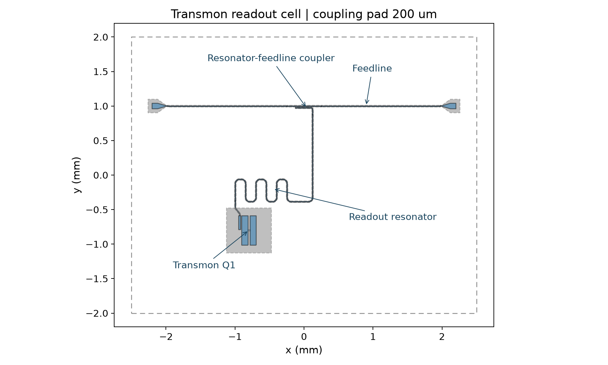
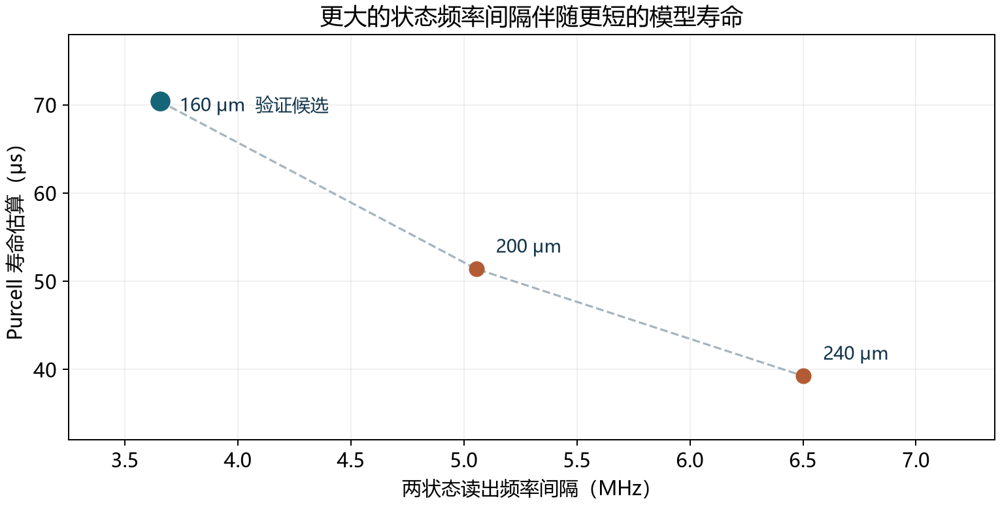
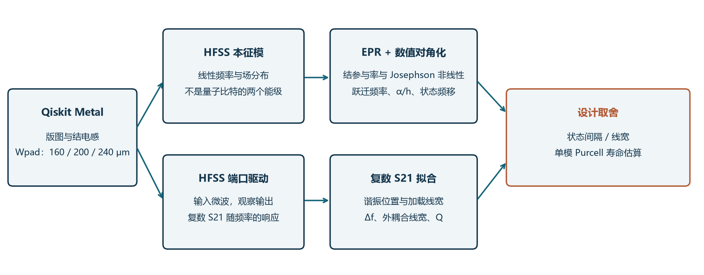

# Transmon Readout Cell

**Design and Optimization of a Transmon Readout Cell Using Qiskit Metal and HFSS**

A three-point electromagnetic and quantum design study of one fixed-frequency,
single-junction transmon, one quarter-wave CPW readout resonator, and a two-port
feedline. The readout coupling-pad width is swept over **160, 200, and 240 μm**.

**Result:** increasing the pad width from 160 to 240 μm increases the calculated
state-dependent frequency separation by about **78%**, while the single-mode
Purcell-limited lifetime estimate decreases by about **44%**. The loaded linewidth
stays near **0.36 MHz**. Under the stated screening rule, 160 μm is the next
validation candidate, not a demonstrated global optimum.



## Start here / 展示入口

- **[Presentation notebook](Transmon_Readout_Project.ipynb)** — Chinese narrative,
  English technical title, executed tables and embedded figures. Viewing or running
  this notebook uses saved data and does **not** start HFSS.
- **[HTML presentation](Transmon_Readout_Presentation.html)** — download and open
  in a browser to view the presentation without Python or an AEDT license.
  GitHub displays the notebook; it normally shows HTML as source until downloaded.
- [Reproduction guide](docs/REPRODUCING.md)
- [Data dictionary and notation](docs/DATA_DICTIONARY.md)
- [Textbook map and interview notes](docs/INTERVIEW_NOTES.md)

## Results

| Pad width (μm) | Qubit transition (GHz) | Ground-state readout transition, EPR (GHz) | State separation (MHz) | Loaded linewidth (MHz) | Purcell estimate (μs) |
|---:|---:|---:|---:|---:|---:|
| 160 | 4.653 | 6.453 | 3.655 | 0.369 | 70.384 |
| 200 | 4.640 | 6.426 | 5.054 | 0.362 | 51.403 |
| 240 | 4.615 | 6.385 | 6.502 | 0.363 | 39.261 |



The pad changes qubit–resonator coupling and capacitive loading. The separate
resonator–feedline coupling geometry is held fixed, which helps explain the small
linewidth variation. Fixed-frequency means no SQUID flux tuning during operation;
it does not mean the frequency stays fixed when the geometry is redesigned.

## Method



1. **Qiskit Metal:** parameterized geometry using standard transmon, CPW routing,
   coupler, and launch-pad components.
2. **HFSS eigenmode:** linearized Josephson inductance, resonant frequencies, and
   electromagnetic field patterns.
3. **pyEPR:** junction participation and numerical diagonalization to obtain dressed
   transitions, anharmonicity, and full state-dependent frequency separation.
4. **HFSS driven modal:** two 50 Ω ports; coarse location followed by a fine sweep.
5. **Analysis:** complex S21 fit, loaded and external linewidths, inferred effective
   coupling, and a single-mode dispersive Purcell estimate.

## Run the saved-data presentation

The recorded environment is **Python 3.14.10 on Windows x64**. This environment is
tested; installation in a fresh environment or on another operating system has not
been validated. The requirements files separate saved-data viewing from HFSS work.

```console
python -m pip install -r requirements-view.txt
jupyter lab Transmon_Readout_Project.ipynb
```

To recompute the analysis and checks from the committed CSV/JSON data, without HFSS:

```console
python analyze.py
python validate_results.py
python build_presentation_figures.py
python build_presentation.py --execute --html
```

The builder executes saved-data cells in the current Python process by default.
For execution through a separate Jupyter kernel, use `--execution-mode kernel`
after registering `qmetal2026` as described in the reproduction guide. The supplied
executed notebook and HTML do not require registration merely to view.

## Full HFSS reproduction

Requires an installed, licensed **Ansys Electronics Desktop 2026 R1** and the
recorded Quantum Metal / PyAEDT / pyEPR stack. Results from saved data are not a
substitute for this solver installation.

```console
python -m pip install -r requirements-verified.txt
python run_study.py --project my_readout_cell
python analyze.py
python validate_results.py
```

Use a **fresh project name after changing geometry**. The runner reuses existing
HFSS designs and does not automatically replace their geometry. The included AEDT
project preserves the original six designs; solver caches are omitted, so solving
again is necessary to recover missing field solutions.

## Validation and limits

- Three eigenmode and three driven cases meet the configured mesh criteria.
- Fine sweep spacing is approximately 50 kHz, about seven intervals per linewidth.
- Complex fit RMS is about 3–4 × 10⁻⁶; changing sweep sampling changes the fitted
  linewidth by less than 0.002% in the saved study.
- Reciprocity and ideal lossless power balance checks pass.
- A basis-size sensitivity comparison is included for the 200 μm case.

These are numerical checks, not an absolute error guarantee. In particular:

- PEC conductors, lossless silicon, zero junction capacitance, and a simplified
  enclosure exclude real material/interface/package losses.
- Effective coupling is inferred from the EPR shift, without an independent
  avoided-crossing extraction.
- The Purcell calculation is a single-mode dispersive estimate, not measured T1 or
  a complete multimode environment calculation.
- Eigenmode/EPR and driven models use different port loading. Their center
  frequencies cannot be subtracted to obtain the qubit-state shift.
- Kerr/participation mesh sensitivity, state-dependent driven response, pulse
  optimization, readout noise, and fidelity still need further validation.

## Repository layout

```text
Transmon_Readout_Project.ipynb       Executed presentation notebook
Transmon_Readout_Presentation.html  Code-hidden browser presentation
cell.py                            Geometry and design parameters
run_hfss.py / run_study.py          HFSS stages / complete three-width study
analyze.py / validate_results.py    Fit, comparison, and numerical checks
build_presentation*.py              Rebuild presentation and figures
models/readout_cell_v2.aedt         Original HFSS project, without solver cache
results/                           Raw S21 CSV, EPR summaries, fields, checks
figures/                           Presentation and verification figures
docs/                              Reproduction, notation, textbook mapping
```

`MANIFEST.json` records the files and SHA-256 hashes in the packaged release.
Runtime caches, earlier calibration attempts, checkpoints, and machine-specific
logs are excluded. Public JSON paths are relative provenance references. Original
solver numbers and the AEDT model are preserved.

## Upload to Git

Extract the package and use its top-level project folder as the repository root.
After creating an empty remote repository, replace `YOUR_REPOSITORY_URL` below:

```console
git init
git add .
git commit -m "Add transmon readout cell design study"
git branch -M main
git remote add origin YOUR_REPOSITORY_URL
git push -u origin main
```

No remote repository is configured by this package. No repository-wide license has
been selected; third-party dependencies retain their own licenses. See [NOTICE](NOTICE.md).

## References

- Minev et al., *Energy-participation quantization of Josephson circuits*,
  npj Quantum Information 7, 131 (2021), [arXiv:2010.00620](https://arxiv.org/abs/2010.00620).
- Blais et al., *Circuit Quantum Electrodynamics*, Rev. Mod. Phys. 93, 025005 (2021),
  [arXiv:2005.12667](https://arxiv.org/abs/2005.12667).
- [Qiskit Metal transmon/resonator tutorial](https://qiskit-community.github.io/qiskit-metal/tut/4-Analysis/4.13-Analyze-transmon-and-resonator.html).
- [Qiskit Metal S21 fitting tutorial](https://qiskit-community.github.io/qiskit-metal/tut/4-Analysis/4.17-Fit-S21-of-Hanger-Resonator-Geometry.html).

The study is a simulation portfolio project; it does not include a fabricated or measured device.
